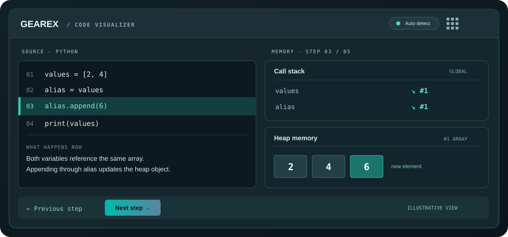
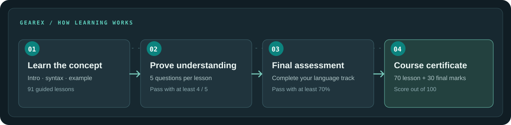

<div align="center">
  
  <h1>GearEx</h1>
  <p><strong>Don't just run the code. Follow it.</strong></p>
  <p>A free, open-source programming workbench built around practice, understanding, and visible progress.</p>
  <p>
    <a href="https://nittinchughani.github.io/gearex/"></a>
    <a href="LICENSE"></a>
    
  </p>
  <p><a href="https://nittinchughani.github.io/gearex/">Visit the website</a> · <a href="docs/CURRICULUM.md">Explore the curriculum</a> · <a href="CONTRIBUTING.md">Contribute</a></p>
</div>

---

## The idea

Reading code is one thing. Understanding what happens inside a program is another.

**GearEx** brings guided programming lessons, practical coding challenges, a built-in **Code Visualizer**, assessments and course certificates together in one place. It helps learners trace fundamental code operations and see how variables, function calls, stack frames and heap objects change.

No signup is needed. The website is open-source, built with HTML, CSS and JavaScript, and hosted on GitHub Pages.

## What you can learn

| Language | Lessons | Focus areas |
|:--|--:|:--|
| **C** | 25 | Variables, arrays, pointers, functions, memory and data structures |
| **C++** | 26 | OOP, references, STL, templates and algorithms |
| **Python** | 8 | Types, loops, functions, lists, dictionaries and objects |
| **JavaScript** | 8 | Arrays, functions, objects and asynchronous fundamentals |
| **Java** | 8 | Data types, methods, objects and inheritance |
| **C#** | 8 | Methods, arrays, properties and LINQ |
| **SQL** | 8 | SELECT, filters, aggregates, grouping and joins |
| **Total** | **91** | Seven guided learning tracks |

<details>
<summary><strong>More ways to practice</strong></summary>
<br>

| Learning resource | Available |
|:--|--:|
| C/C++ coding challenges | 138 |
| Guided C/C++ projects | 12 |
| General quiz questions | 113 |
| Lesson-specific knowledge checks | 455 (5 per lesson) |
| Creator-issued course certificates | One per language, after meeting completion requirements |

</details>

## Meet the Code Visualizer

<p align="center">
  
</p>

GearEx has a **built-in Code Visualizer** to help learners understand how code works by tracing it step by step.

Use a short example from a lesson, write your own source, or click **Trace my code** from the **Compiler**. GearEx recognizes familiar syntax and provides:

- **Line-by-line stepping** with highlighted source and explanations.
- **Call-stack views** showing function frames and variables.
- **Heap diagrams** for arrays, objects and shared references.
- **Output tracking** and Previous, Next, Play and Reset controls.
- **Automatic language detection** across the seven course languages.

**Accuracy and scope:** the visualizer is a browser-based *educational interpreter* for supported foundational features, **not a full debugger or complete language runtime**. Advanced operations and unsupported library calls can stop with a coverage note. For SQL, the visualizer explains query stages; use the Compiler to run SQL queries and see actual results.

## A learning flow that measures understanding

<p align="center">
  
</p>

A lesson doesn't count as complete simply because someone opened it. Every lesson ends with **five questions**, and learners need **4/5** correct to verify it. The best result from retakes counts toward the certificate.

After all lessons in a language are verified, a final assessment opens. Learners must score **70% or higher** to unlock the certificate.

| Certificate component | Raw score used | Weighted marks |
|:--|:--|--:|
| Lesson checks | Best score across all lessons in a language | **70** |
| Final assessment | Correct answers on the language's final assessment | **30** |
| **Overall** | **Both components combined** | **100** |

Certificates display the learner's name, language, score breakdown, total marks, overall performance, issue date and **Certified by creator: Nittin Chughani**.

Names are entered and confirmed once per browser through the normal interface. These certificates document self-paced learning; because records are saved locally, they are **not identity-verified, tamper-proof or institution-accredited**.

## Designed around your workflow

GearEx uses a **focused, single-page interface**. Clicking a navigation item switches to its own view—there is no need to scroll past the entire website to reach the Compiler, a course or the Code Visualizer. Lessons and projects also open in their own detail views.

<details open>
<summary><strong>Appearance and personalization</strong></summary>
<br>

At the **top-right corner**, a light/dark switch changes the reading mode. Beside it, a nine-square **theme launcher** offers five choices:

| Theme option | Color accents |
|:--|:--|
| **No theme** | Neutral workspace, without a custom palette |
| **Cyberpunk Neon** | Cyan · magenta · deep orchid |
| **Quantum Teal** | Teal · aqua · lunar grey |
| **Synthwave Sunset** | Violet · yellow · tangerine |
| **Bio-Digital Matrix** | Lime · mint · tactical navy |

The default for new visitors is **Light mode + No theme**. Both settings are remembered locally, so returning visitors keep their chosen look. Dark mode can be combined with any of the four colored themes. Theme selection and mode switching work independently.

Subtle transitions, animated code-step feedback and responsive layouts make navigation feel smoother, with a **Reduced Motion** alternative for visitors who prefer it.

</details>

## Write and run code in the Compiler

The GearEx **Compiler** lets you edit programs and request execution in C, C++, Python, JavaScript, Java, C# and SQL, subject to the available runtime.

Actual code execution uses the external [Wandbox](https://wandbox.org/) service. Internet access is required, and available language runtimes or quotas can change. **Don't include passwords or personal information in submitted code.**

The Code Visualizer is separate from the Compiler and works locally in the browser for its supported teaching subset.

## Getting started

**[Open the live website](https://nittinchughani.github.io/gearex/)** to begin immediately, or run a local copy:

```bash
git clone https://github.com/NittinChughani/gearex.git
cd gearex
python -m http.server 8000
```

Then open `http://localhost:8000` in your browser. No framework, npm install or account is required.

### Project structure

```text
gearex/
├── index.html                     # Navigation, views and markup
├── assets/
│   ├── favicon.svg               # GearEx brand identity
│   ├── style.css                 # Existing component styles
│   ├── studio.css                # Programming-studio UI
│   ├── navigation-shell.css      # Light/dark switch, palettes, view transitions
│   ├── studio-motion.js          # View animation and staggered cards
│   ├── app.js                    # Hash routing, lessons, compiler, progress
│   ├── gearex-engine.js          # Built-in teaching interpreter
│   ├── gearex-trace-ui.js        # Code Visualizer stack/heap interface
│   ├── gearex-features.js        # Assessments and certificates
│   ├── lesson-assessments.js     # Five-question lesson completion tests
│   ├── data.js                   # C/C++ curriculum
│   ├── gearex-courses.js         # Other five language tracks
│   ├── challenges.js            # C/C++ practice
│   ├── projects.js              # C/C++ project briefs
│   └── readme/                  # Original explanatory diagrams
├── docs/                          # Curriculum and development notes
├── scripts/                       # Validation and unit tests
└── .github/workflows/            # CI validation
```

### Run the checks

```bash
node scripts/check-content.cjs
node --test scripts/test-tracer.cjs
```

GitHub Actions checks JavaScript syntax, curriculum integrity and visualizer behavior. GearEx remains a static website that can be deployed directly to GitHub Pages.

## Progress, privacy and collaboration

Saved themes, lesson progress, scores, bookmarks and drafts are stored using your browser's **localStorage**. The Dashboard includes **Export progress** and **Import progress**; local settings and achievements don't automatically sync between devices.

Contributions that improve lesson quality, compiler reliability, tracing coverage, accessibility, testing and translations are welcome. See [CONTRIBUTING.md](CONTRIBUTING.md) before opening a pull request.

---

<div align="center">
  
  <p><strong>Created by Nittin Chughani</strong></p>
  <p>A Computer Science &amp; Engineering student building useful open-source tools that help people learn and solve everyday problems.</p>
  <sub>Made for people who learn by building · MIT License</sub>
</div>