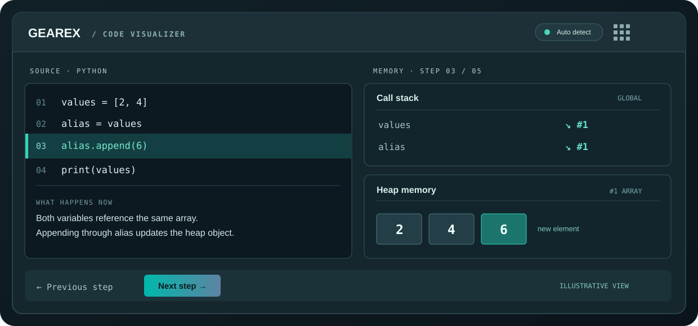
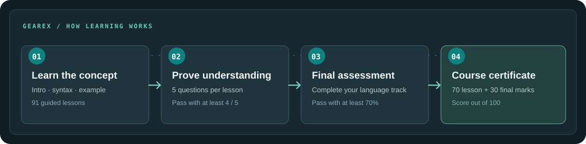

<div align="center">
  
  <h1>GearEx</h1>
  <p><strong>Don't just run the code. Follow it.</strong></p>
  <p>A free, open-source programming workbench built around practice, understanding, and visible progress.</p>
  <p>
    <a href="https://gearex.vercel.app/"></a>
    <a href="LICENSE"></a>
    
  </p>
  <p><a href="https://gearex.vercel.app/">Visit the website</a> · <a href="docs/CURRICULUM.md">Explore the curriculum</a> · <a href="CONTRIBUTING.md">Contribute</a></p>
</div>

---

## The idea

Reading code is one thing. Understanding what happens inside a program is another.

**GearEx** brings guided programming lessons, practical coding challenges, a built-in **Code Visualizer**, assessments and course certificates together in one place. It helps learners trace fundamental code operations and see how variables, function calls, stack frames and heap objects change.

No signup is needed. The website is open-source, built with HTML, CSS and JavaScript, and hosted primarily on Vercel, with GitHub Pages retained as a secondary deployment.

## Optional accounts and personal learning space

GearEx remains entirely usable as a **guest**: all seven language tracks, the compiler, Code Visualizer, lessons, quizzes and certificates remain available without creating an account.

The live website includes a personalized dashboard with a **display name, user-selected profile photo**, animated progress cards, Continue Learning recommendations, and a saved-program gallery. A signed-in Supabase account can privately synchronize completed lessons, scores, certificates and code drafts across devices. On a first sign-in, the learner explicitly chooses whether to import existing guest progress; code-draft conflicts preserve a second copy.

**Live status (18 November 2026):** GearEx is live at **[gearex.vercel.app](https://gearex.vercel.app/)**. Google sign-in works for public users, and cloud lesson progress persists on Vercel after refreshing. Profile name/photo persistence has been manually tested with Supabase. Automated content, compiler, account-model and guest browser checks pass; email magic-link sign-in and full multi-account privacy checks have not been confirmed end-to-end for this release.

**Account deletion status (18 November 2026):** the `delete-account` Supabase Edge Function is deployed and **ACTIVE (v2)**. It now allows browser requests from both `https://gearex.vercel.app` and the previous GitHub Pages origin, while requiring a verified Supabase session and explicit `DELETE` confirmation. An actual signed-in account deletion was successfully tested on the previous GitHub Pages deployment; the new Vercel origin needs a final disposable-account end-to-end test. Cloud profile/progress foreign keys use `ON DELETE CASCADE`, and avatar storage is private. The [account deletion health workflow](.github/workflows/deploy-account-deletion.yml) checks the live endpoint on changes and weekly **without a Supabase access token**; it does not deploy new function code.

**Supabase setup for maintainers and forks:** [Read the setup and secure deployment guide](docs/SUPABASE_SETUP.md), including database RLS, private photo storage, authentication redirects and the account-deletion function.


## What you can learn

| Language | Lessons | Focus areas |
|:--|--:|:--|
| **C** | 25 | Variables, arrays, pointers, functions, memory and data structures |
| **C++** | 26 | OOP, references, STL, templates and algorithms |
| **Python** | 8 | Types, loops, functions, lists, dictionaries and objects |
| **JavaScript** | 8 | Arrays, functions, objects and asynchronous fundamentals |
| **Java** | 8 | Data types, methods, objects and inheritance |
| **C#** | 8 | Methods, arrays, properties and LINQ |
| **SQL** | 8 | SELECT, filters, aggregates, grouping and joins |
| **Total** | **91** | Seven guided learning tracks |

<details>
<summary><strong>More ways to practice</strong></summary>
<br>

| Learning resource | Available |
|:--|--:|
| C/C++ coding challenges | 138 |
| Guided C/C++ projects | 12 |
| General quiz questions | 113 |
| Lesson-specific knowledge checks | 455 (5 per lesson) |
| Creator-issued course certificates | One per language, after meeting completion requirements |

</details>

## Lessons that teach from the beginning

Every one of the **131 lessons** now has a full, topic-specific learning guide. Instead of leaving a new learner with a short definition, each lesson provides four readable stages:

| Stage | What you'll understand |
|:--|:--|
| **01 · What does it mean?** | The idea in plain language, with terminology explained rather than assumed |
| **02 · Let's unpack the example** | What the actual example does, how values change, and why each major part matters |
| **03 · Where is it useful?** | A concrete situation where the concept is used |
| **04 · Think before you run** | A specific change or prediction to practice independent reasoning |

For example, the **C Variables & Data Types** lesson explains why an `int` holds whole numbers, how `double` differs, what `char` represents, how the values in the code are initialized, and why `printf` uses different format specifiers. The new guides sit alongside syntax references, worked code, output, challenges, and **five-question completion assessments**. Existing scores and certificates remain intact.

## Meet the Code Visualizer

<p align="center">
  
</p>

GearEx has a **built-in Code Visualizer** to help learners understand how code works by tracing it step by step.

Use a short example from a lesson, write your own source, or click **Trace my code** from the **Compiler**. GearEx recognizes familiar syntax and provides:

- **Larger source editor, completion and replay:** The expanded coding area shows more lines at once. The last execution step displays **Program ended** and a **Run visualizer again** control.
- **Manual or Auto playback:** click **Play trace** and choose **Manual — Next step** (recommended for learning) or **Auto run**. Manual moves one instruction at a time; Auto uses timed steps and can be paused.
- **Line-by-line stepping** with highlighted source and explanations.
- **Call-stack views** showing function frames and variables.
- **Heap diagrams** for arrays, objects and shared references.
- **Output tracking** and Previous, Next, Play and Reset controls.
- **Input-aware tracing** that pauses at supported input requests, asks for the value, then resumes execution and updates variables, stack frames and output. Multiple inputs inside loops are requested as execution reaches them.
- **Visible source errors before tracing:** GearEx checks common syntax problems and supported-subset execution errors before playback. An affected source line turns **red** in the editor, with the exact error and clickable line number displayed in **red** below it. When no issue is found, the status shows **“Code is Ready for Tracing”** in **green**. Editing the code clears the old status so you can check the corrected version.
- **Automatic language detection** across the seven course languages.

**Input support:** the native Code Visualizer can pause for Python `input()`, JavaScript `prompt()`, C `scanf()` and `getchar()`, C++ `cin` and `getline()`, Java `Scanner.nextInt()/nextLine()/next()`, and C# `Console.ReadLine()` in supported basic examples. Input prompts are local to your browser; your answers are used to rebuild the educational trace rather than submitted to an online debugging website.

**Validation scope:** the local preflight identifies common missing semicolons in C, C++, Java and C# declarations, assignments, output statements and returns—not just variable declarations. It also checks malformed initializers, unmatched brackets, unclosed string literals and common Python colon/indentation mistakes. JavaScript and Python do not require semicolons at the end of ordinary statements. It also checks for runtime and unsupported-subset issues that can be observed without additional input. The visualizer supports grouped declarations like `int a,b;` and `int a=3, b=5;`. These are **basic checks, not a complete compiler or language syntax certification**; other errors may be discovered after input is provided. Use **Compiler** for full language diagnostics.

**Headers and namespaces:** The visualizer recognizes C/C++ `#include` and `using namespace std;` directives as setup steps. Some common math functions such as `sqrt`, `pow`, `abs` and `sin` can be traced in simple examples, but it **does not execute arbitrary header implementations or third-party libraries**. Full compilation uses the remote Compiler with whichever headers the provider actually has installed.

**Accuracy and scope:** the visualizer is a browser-based *educational interpreter* for supported foundational features, **not a full debugger or complete language runtime**. Advanced operations and unsupported library calls can stop with a coverage note. For SQL, the visualizer explains query stages; use the Compiler to run SQL queries and see actual results.

## A learning flow that measures understanding

<p align="center">
  
</p>

A lesson doesn't count as complete simply because someone opened it. Every lesson ends with **five questions**, and learners need **4/5** correct to verify it. The best result from retakes counts toward the certificate.

After all lessons in a language are verified, a final assessment opens. Learners must score **70% or higher** to unlock the certificate.

| Certificate component | Raw score used | Weighted marks |
|:--|:--|--:|
| Lesson checks | Best score across all lessons in a language | **70** |
| Final assessment | Correct answers on the language's final assessment | **30** |
| **Overall** | **Both components combined** | **100** |

Certificates display the learner's name, language, score breakdown, total marks, overall performance, issue date and **Certified by creator: Nittin Chughani**.

Names are entered and confirmed once per browser through the normal interface. These certificates document self-paced learning; because records are saved locally, they are **not identity-verified, tamper-proof or institution-accredited**.

## Designed around your workflow

GearEx uses a **focused, single-page interface**. Clicking a navigation item switches to its own view—there is no need to scroll past the entire website to reach the Compiler, a course or the Code Visualizer. Lessons and projects also open in their own detail views.

<details open>
<summary><strong>Appearance and personalization</strong></summary>
<br>

At the **top-right corner**, a light/dark switch changes the reading mode. Beside it, a nine-square **theme launcher** offers five choices:

| Theme option | Color accents |
|:--|:--|
| **No theme** | Neutral workspace, without a custom palette |
| **Cyberpunk Neon** | Cyan · magenta · deep orchid |
| **Quantum Teal** | Teal · aqua · lunar grey |
| **Synthwave Sunset** | Violet · yellow · tangerine |
| **Bio-Digital Matrix** | Lime · mint · tactical navy |

The default for new visitors is **Light mode + No theme**. Both settings are remembered locally, so returning visitors keep their chosen look. Dark mode can be combined with any of the four colored themes. Theme selection and mode switching work independently.

Subtle transitions, animated code-step feedback and responsive layouts make navigation feel smoother, with a **Reduced Motion** alternative for visitors who prefer it.

</details>

## Write and run code in the Compiler

The GearEx **Compiler** lets you edit programs and request execution in C, C++, Python, JavaScript, Java, C# and SQL, subject to the available runtime.

### Interactive input in the Compiler

When code uses a recognized input command and the standard-input box is empty, GearEx displays a **guided input prompt** before running the program. You can enter the requested values in order, add extra input lines for loops, then run. The **Standard input** field also remains available if you prefer to paste all inputs yourself. For JavaScript programs using `prompt()`, the remote Node runtime receives a small standard-input adapter so the program can use the provided answers.

**Technical limitation:** the hosted compiler services take standard input **before** execution; they do not provide a live interactive terminal session. GearEx collects values in advance and passes them to the compiler as stdin, then shows the real program output. Programs with input requirements that cannot be determined statically may need additional lines entered manually. The Code Visualizer is different: it can actually pause and ask during its supported execution trace.


Actual code execution uses **[OnlineCompiler.io](https://onlinecompiler.io/)** through its browser WebSocket API, using the original GearEx editor rather than an embedded third-party editor. The new API supports **C, C++, Python, JavaScript, Java, C# and SQLite**, with built-in standard headers. Programs are sent unchanged, except for the already-documented Node `prompt()` stdin adapter.

**Configured:** GearEx uses **two separate public OnlineCompiler.io widget/WebSocket keys** in `assets/compiler-config.js`, automatically selected by the browser's exact origin: the new widget key for `https://gearex.vercel.app`, and the original widget key for `https://nittinchughani.github.io`. Each key is restricted to its respective website in the provider dashboard. No separate `widget.js` editor is embedded—the original GearEx compiler sends runs through the documented Socket.IO API. Widget keys are designed for public browsers and **are not private REST API keys**; never publish secret credentials. Unknown origins do not receive a production key, so their compiler remains unavailable until configured. Visitors do not need a GearEx account to run code.

**Responsiveness:** GearEx prewarms and reuses an authenticated WebSocket. Normal warm runs retain a **7-second execution-response budget**. A brand-new visit allows up to **18 seconds total** to accommodate a cold connection and initial execution; only a failed connection handshake may be retried, **never a submitted program**. The UI distinguishes provider delays from code errors and guides focus to input or output. Actual runtime performance and availability depend on the external provider and the learner's network.

**Verification:** earlier live smoke tests successfully executed C, C++, Python, JavaScript, Java, C# and SQL with the GitHub Pages origin, including an intentional compiler error. The current [Vercel-origin smoke workflow](.github/workflows/live-compiler-smoke.yml) checks the new production origin; successful local/simulated connection tests do not guarantee a specific provider account's origin allowlist, limits or real-browser behavior. The [earlier GitHub Pages provider smoke run](https://github.com/NittinChughani/gearex/actions/runs/43880876135) is retained for reference.

**Privacy:** source code and standard input are sent to the external execution service. Do not include credentials or personal information. Refer to the provider's data policy if submitting sensitive material.

The Code Visualizer is separate from the Compiler and works locally in the browser for its supported teaching subset.

**Interaction feedback:** the Compiler and Visualizer scroll to and briefly highlight requested input and produced output. Profile changes, photo uploads, account deletion, sign-in and progress imports have visible progress states; user-initiated changes show accessible confirmation or error toasts. Successful account deletion displays confirmation after returning to guest mode.

## Getting started

**[Open the live website](https://gearex.vercel.app/)** to begin immediately, or run a local copy:

```bash
git clone https://github.com/NittinChughani/gearex.git
cd gearex
python -m http.server 8000
```

Then open `http://localhost:8000` in your browser. No framework, npm install or account is required.

### Project structure

```text
gearex/
├── index.html                     # Navigation, views and markup
├── assets/
│   ├── favicon.svg               # GearEx brand identity
│   ├── style.css                 # Existing component styles
│   ├── studio.css                # Programming-studio UI
│   ├── navigation-shell.css      # Light/dark switch, palettes, view transitions
│   ├── studio-motion.js          # View animation and staggered cards
│   ├── app.js                    # Hash routing, lessons, compiler UI, progress
│   ├── compiler-config.js        # Public browser widget key (configured by site owner)
│   ├── compiler-service.js       # Prewarmed WebSocket, cold-start budget, execution guard
│   ├── gearex-feedback.js        # Accessible notifications and guided scroll highlights
│   ├── gearex-feedback.css       # Responsive feedback visual styles
│   ├── account-ui.css            # Personalized animated guest/account dashboard
│   ├── gearex-account-data.js    # Normalized, conflict-aware learning snapshots
│   ├── gearex-accounts.js        # Guest-first auth, sync and private profile photos
│   ├── supabase-config.js        # Public project URL/key (blank until activated)
│   ├── lesson-guides.js          # 91 detailed, topic-specific beginner explanations
│   ├── gearex-engine.js          # Built-in teaching interpreter
│   ├── gearex-trace-ui.js        # Code Visualizer stack/heap interface
│   ├── gearex-features.js        # Assessments and certificates
│   ├── lesson-assessments.js     # Five-question lesson completion tests
│   ├── data.js                   # C/C++ curriculum
│   ├── gearex-courses.js         # Other five language tracks
│   ├── challenges.js            # C/C++ practice
│   ├── projects.js              # C/C++ project briefs
│   └── readme/                  # Original explanatory diagrams
├── docs/                          # Curriculum, setup and development notes
├── supabase/                      # RLS schema and secure deletion Edge Function
├── scripts/                       # Validation and unit tests
└── .github/workflows/            # CI validation
```

### Run the checks

```bash
node scripts/check-content.cjs
node --test scripts/test-tracer.cjs
node --test scripts/test-compiler.cjs
node --test scripts/test-accounts.cjs
```

Local browser checks for guest profiles, code saving and responsive layout are available through `scripts/test-account-browser.cjs` and the dedicated GitHub Actions browser workflow (Playwright required).

GitHub Actions checks JavaScript syntax, curriculum integrity and visualizer behavior. GearEx remains a static website; the GitHub `main` branch is connected to Vercel for automatic deployments, and GitHub Pages remains an option.

## Progress, privacy and collaboration

**Guests:** themes, progress, lesson scores, bookmarks, optional photos and drafts are stored in this device's **localStorage**. The dashboard supports Export/Import progress and saved programs. **Signed-in users (after Supabase is configured):** learning snapshots and photos sync to private account records, protected by Supabase Row Level Security; email is managed by Supabase Auth. Browser code execution still sends source and program input to OnlineCompiler.io. No signup is needed. Users can remove profile photos and request secure account deletion using the project-owner-deployed Edge Function. See the in-site Privacy view.

Contributions that improve lesson quality, compiler reliability, tracing coverage, accessibility, testing and translations are welcome. See [CONTRIBUTING.md](CONTRIBUTING.md) before opening a pull request.

---

<div align="center">
  
  <p><strong>Created by Nittin Chughani</strong></p>
  <p>A Computer Science &amp; Engineering student building useful open-source tools that help people learn and solve everyday problems.</p>
  <sub>Made for people who learn by building · MIT License</sub>
</div>